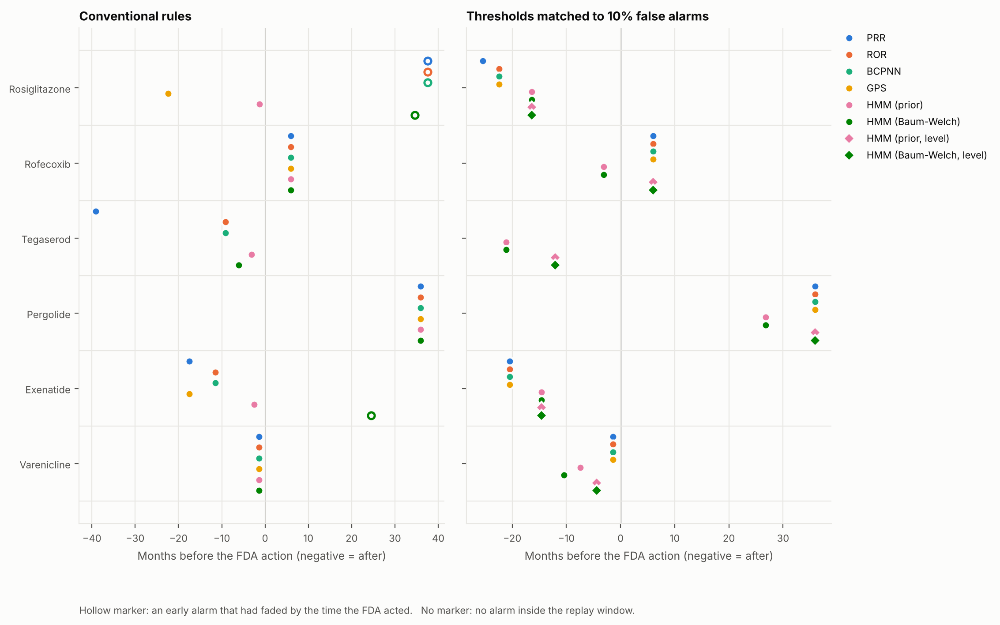
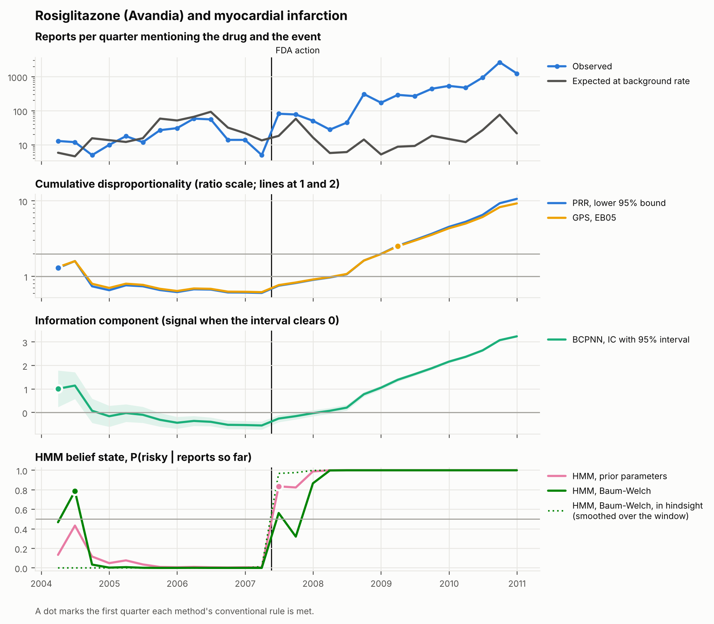
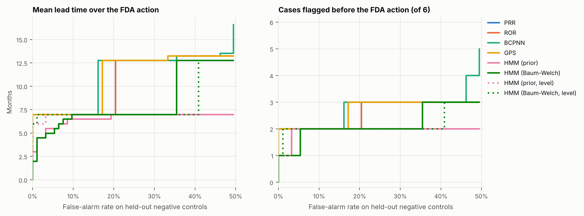
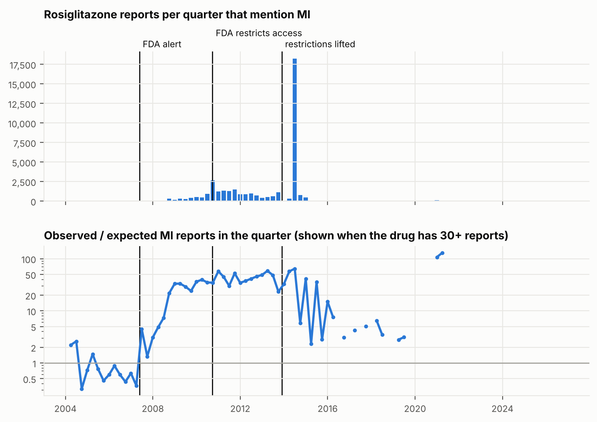
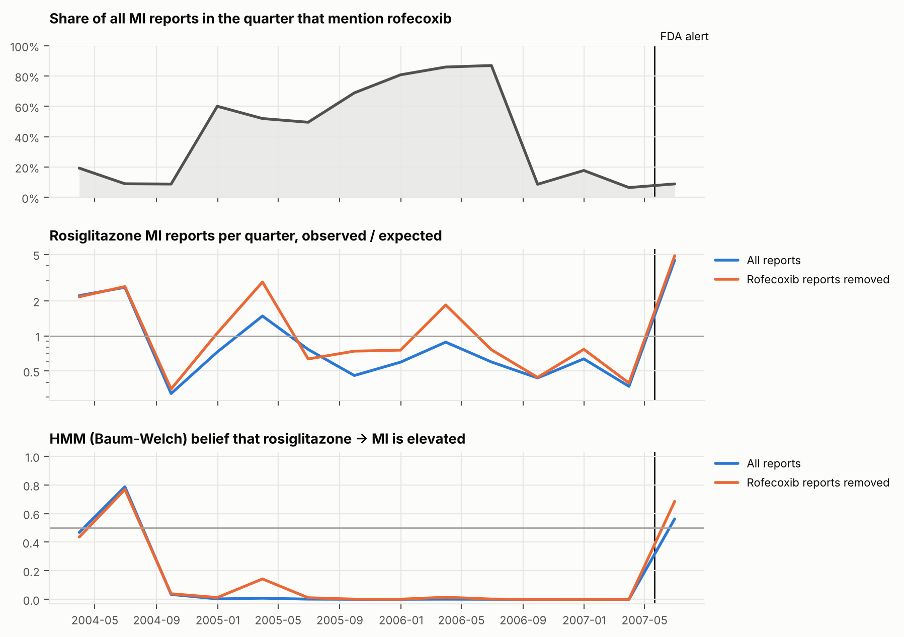

# Knowing When We Knew

**Sequential belief-state detection of adverse drug reaction signals in FAERS**

CS 5100: Foundations of Artificial Intelligence, course project. Avika Khemuka.

Regulators score drug safety databases as they stand today. The question that
matters is temporal: *when* did the evidence first justify acting? This project
replays FDA adverse event reports quarter by quarter, tracks a hidden
safe/risky state for each (drug, event) pair with a hidden Markov model, and
compares the quarter each method would have raised an alarm against the date
the FDA actually acted.

## Findings

1. **For most of the historical cases, FAERS did not know before the FDA did.**
   Of six cases with an action date inside the data, only two (rofecoxib and
   pergolide) had an alarm standing when the FDA acted, and both were already
   signalling in the first quarter of available data. For rosiglitazone,
   tegaserod, exenatide and varenicline the reporting surge came *after* the
   regulatory action, not before it.
2. **The HMM reacts to a change in reporting much faster than the static
   methods.** Once rosiglitazone's reporting shifted in 2007Q2, the HMM belief
   crossed 0.5 that same quarter. BCPNN needed until 2008Q2 and GPS until
   2009Q1, because cumulative scores are diluted by years of unremarkable
   history.
3. **That speed costs false alarms.** At belief >= 0.5 the HMM flags 53-58% of
   held-out negative controls, against 14-50% for the static rules. When every
   method is tuned to the same 10% false-alarm rate, no method flags any of
   the four "surge after action" cases early.
4. **Stimulated reporting dominates the rosiglitazone record.** Before the
   FDA alert, 2.7% of rosiglitazone reports mentioned myocardial infarction,
   below the background rate. Afterwards the share rose to 34-43%.



## Problem

For a (drug, event) pair, time is cut into quarters. The true safety status
`z_t` in {safe, risky} is hidden. Each quarter gives a 2x2 table of report
counts:

|                | event | no event |
|----------------|-------|----------|
| **drug**       | a     | b        |
| **other drugs**| c     | d        |

The output per quarter is a set of disproportionality scores, a posterior
belief `P(z_t = risky | reports up to t)`, and one alarm decision: the first
quarter the method flags the pair.

## Data

Counts come from the [openFDA drug adverse event API](https://open.fda.gov/apis/drug/event/),
the public interface to FAERS, using `count=receivedate` aggregations. Four
daily series per pair (all reports, drug, event, both) are summed into
quarters. The snapshot in `data/processed/` was fetched on 2026-11-24 from the
openFDA release dated 2026-10-28 and covers 2004Q1 to 2026Q3.

**Historical cases** (`data/reference/cases.json`):

| Drug | Event | FDA action | Date |
|------|-------|------------|------|
| Rosiglitazone (Avandia) | Myocardial infarction | Safety alert, then boxed warning (2007-11-14) | 2007-05-21 |
| Rofecoxib (Vioxx) | Myocardial infarction | Market withdrawal | 2004-09-30 |
| Cerivastatin (Baycol) | Rhabdomyolysis | Market withdrawal | 2001-08-08 |
| Tegaserod (Zelnorm) | Ischaemic cardiovascular events | Marketing suspended | 2007-03-30 |
| Pergolide (Permax) | Cardiac valve disease | Market withdrawal | 2007-03-29 |
| Exenatide (Byetta) | Acute pancreatitis | FDA alert | 2007-10-16 |
| Varenicline (Chantix) | Suicidal ideation or behaviour | Early communication | 2007-11-20 |

The first three are the cases named in the proposal. The other four are
stretch cases. Cerivastatin was withdrawn before openFDA coverage begins, so
it is shown as a sanity check and excluded from lead-time results.

**Controls** (`data/reference/omop_reference_set.csv`): the OMOP reference set
(Ryan et al., 2013), taken from the OHDSI `MethodEvaluation` package. It lists
drug-outcome pairs with and without a known causal link for four outcomes:
acute myocardial infarction, acute liver injury, acute renal failure and upper
GI bleeding. After mapping to FAERS drug names, 388 pairs remain. They are
split in two by drug, so no drug appears on both sides:

| | Negative controls | Known positives |
|---|---|---|
| Tuning split | 94 | 69 |
| Held-out split | 93 | 78 |

Pairs whose drug has fewer than 100 reports in the replay window are dropped
(54 pairs), since an alarm on them is close to impossible for any method.

Events are defined as lists of MedDRA preferred terms in
`data/reference/events.json`. A report counts for a drug if the drug is
mentioned in any role.

## Methods

**PRR and ROR** (`src/kwwk/disproportionality.py`). The ratio of the event's
reporting rate with the drug to its rate with all other drugs. PRR signals by
Evans' rule: PRR >= 2, chi-square >= 4 and at least 3 cases. ROR signals when
its lower 95% bound is above 1.

**BCPNN** (`src/kwwk/bcpnn.py`). The Information Component

    IC = log2 [ P(drug, event) / ( P(drug) P(event) ) ]

with the Beta priors of Bate et al. (1998), which shrink IC toward zero when
counts are small. It signals when the lower 95% credible bound IC025 is above 0.

**Gamma-Poisson Shrinker** (`src/kwwk/gps.py`). DuMouchel's empirical Bayes
model: counts are Poisson, the true ratios share a two-gamma mixture prior
fitted by maximum marginal likelihood, and the pair is summarised by EBGM and
its 5th percentile EB05. It signals when EB05 >= 2. The prior is refitted each
quarter on the tuning pairs only.

These four are static, so in the replay they are recomputed each quarter on
the cumulative table: the database as it stood at that quarter's end.

**Hidden Markov model** (`src/kwwk/hmm.py`). The method this project studies.

- *States.* `z_t` in {safe, risky}.
- *Observation.* The quarter's joint count `a_t`, given the count `E_t`
  expected if the drug reported the event at the background rate of all other
  drugs: `E_t = n_drug * c / (c + d)`.
- *Emission.* `a_t | z_t = j ~ NegBin(mean = rho_j * E_t, shape = k_j)`. This
  is a Poisson count whose rate is gamma-distributed around `rho_j`, so `k_j`
  sets how much quarter-to-quarter overdispersion the state tolerates.
- *Transition.* safe -> risky with probability `p` per quarter. Risky is
  absorbing: a one-way shift.
- *Inference.* The forward algorithm in log space, using the log-sum-exp
  trick so that the product of per-quarter likelihoods cannot underflow. It
  yields the filtered posterior `P(z_t = risky | o_1..t)`, the belief state.
  The backward pass gives the smoothed (hindsight) posterior, and Viterbi the
  most likely path.
- *Learning.* Baum-Welch (EM) over many sequences at once. The E-step runs
  forward-backward on each sequence. The M-step updates the initial
  distribution and transition matrix in closed form and the negative-binomial
  parameters by numerical weighted maximum likelihood. Transitions that start
  at zero stay at zero, so the one-way structure survives training.
- *Alarm.* The first quarter the belief crosses a threshold, and never on
  fewer than 3 joint reports.

Two parameter sets are compared:

| Parameter | Set from priors | Learned by Baum-Welch |
|---|---|---|
| P(risky at start) | 0.05 | 0.27 |
| P(safe -> risky) per quarter | 0.02 | 0.011 |
| rho, safe | 1.0 | 0.96 |
| rho, risky | 2.0 | 3.35 |
| k, safe | 4.0 | 2.4 |
| k, risky | 4.0 | 5.0 |

Baum-Welch was trained on the 163 tuning pairs with their labels hidden. It
converged in 14 iterations and reached the same optimum from three different
starting points. It recovers a sensible structure without supervision: a
"safe" state that reports at the background rate and a "risky" state at about
3.4 times it.

**Two ways to tune the HMM on negative controls.** The proposal tunes the
belief threshold. That works poorly here, for a reason worth understanding.
The HMM's log-odds add up evidence quarter after quarter, so a high-volume
pair whose reporting ratio sits stably at 2 or 3 reaches enormous log-odds.
Many OMOP negative controls look exactly like that because of confounding by
indication: lactulose with GI bleeding (given to patients with cirrhosis) has
a PRR of 4.5, and darbepoetin with renal failure a PRR of 2.9. Holding false
alarms to 10% then needs a log-odds threshold near 23 to 26, which makes the
HMM slow on everything.

The belief threshold asks "how sure are we?". The better question for a
confounded pair is "elevated relative to what?". So `hmm.detection_level`
scores each quarter by the largest baseline multiplier `c` at which the pair
would still be flagged, where `c` scales both emission rates. A level of 1 is
the unmodified model, so `level >= 1` is exactly `belief >= 0.5`. Requiring a
higher level demands a larger effect instead of more evidence. Results for
both tunings are reported; the level-tuned HMM appears as "HMM (..., level)".

## Evaluation protocol

- **Replay window:** 2004Q1 to 2010Q4. At quarter `t` a method sees only
  reports received by the end of `t`. A test checks that removing later data
  never changes earlier scores.
- **Alarm date:** the day after the quarter ends. Lead time is the FDA action
  date minus the alarm date, in months.
- **Conventional operating point:** each method's rule from the literature,
  and belief >= 0.5 for the HMM.
- **Matched operating point:** each method's threshold is tuned on the tuning
  negative controls so that at most 10% of them ever alarm. False alarms are
  then measured on the held-out negative controls.
- **Cases are never used for training or tuning.**

## Results

### False alarms and sensitivity on the reference set

False-alarm rate is the share of held-out negative controls that alarm at any
point in the window. Sensitivity is the same share among held-out known
positives.

| Method | Rule | False alarms | Sensitivity |
|---|---|---|---|
| PRR | PRR >= 2, chi-square >= 4, cases >= 3 | 37.6% | 53.8% |
| ROR | lower 95% bound > 1 | 49.5% | 69.2% |
| BCPNN | IC025 > 0 | 43.0% | 67.9% |
| GPS | EB05 >= 2 | 14.0% | 44.9% |
| HMM (prior) | belief >= 0.5 | 58.1% | 69.2% |
| HMM (Baum-Welch) | belief >= 0.5 | 52.7% | 60.3% |

Tuned to 10% false alarms on the tuning split:

| Method | Tuned threshold | False alarms (held-out) | Sensitivity (held-out) |
|---|---|---|---|
| PRR | lower bound >= 2.57 | 6.5% | 35.9% |
| ROR | lower bound >= 2.63 | 6.5% | 35.9% |
| BCPNN | IC025 >= 1.25 | 5.4% | 32.1% |
| GPS | EB05 >= 2.45 | 6.5% | 34.6% |
| HMM (prior) | log-odds >= 22.8 | 1.1% | 29.5% |
| HMM (Baum-Welch) | log-odds >= 25.9 | 1.1% | 26.9% |
| HMM (prior, level) | level >= 2.98 | 4.3% | 25.6% |
| HMM (Baum-Welch, level) | level >= 2.40 | 6.5% | 30.8% |

Ranking known positives above negatives at the end of the window (ROC AUC on
the held-out split): 0.70 for PRR, ROR, BCPNN and GPS, 0.67 for the level-tuned
HMM, and 0.63-0.64 for the HMM log-odds. On pairs whose association has been
stable for years the HMM has no advantage, and its evidence-based score ranks
worse than an effect-size score.

### When each method alarmed on the historical cases

First alarm under the conventional rules. The number in brackets is the lead
time in months; negative means after the FDA action. A tilde marks an early
alarm that had faded again by the time the FDA acted.

| Case (action date) | PRR | BCPNN | GPS | HMM (prior) | HMM (Baum-Welch) |
|---|---|---|---|---|---|
| Rofecoxib (2004-09-30) | 2004Q1 (+6) | 2004Q1 (+6) | 2004Q1 (+6) | 2004Q1 (+6) | 2004Q1 (+6) |
| Pergolide (2007-03-29) | 2004Q1 (+36) | 2004Q1 (+36) | 2004Q1 (+36) | 2004Q1 (+36) | 2004Q1 (+36) |
| Rosiglitazone (2007-05-21) | 2004Q1 (+38~) | 2004Q1 (+38~) | 2009Q1 (-22) | 2007Q2 (-1) | 2004Q2 (+35~) |
| Tegaserod (2007-03-30) | 2010Q2 (-39) | 2007Q4 (-9) | none | 2007Q2 (-3) | 2007Q3 (-6) |
| Exenatide (2007-10-16) | 2009Q1 (-18) | 2008Q3 (-12) | 2009Q1 (-18) | 2007Q4 (-2) | 2005Q3 (+24~) |
| Varenicline (2007-11-20) | 2007Q4 (-1) | 2007Q4 (-1) | 2007Q4 (-1) | 2007Q4 (-1) | 2007Q4 (-1) |

With thresholds matched to 10% false alarms:

| Case | PRR | BCPNN | GPS | HMM (Baum-Welch) | HMM (Baum-Welch, level) |
|---|---|---|---|---|---|
| Rofecoxib | 2004Q1 (+6) | 2004Q1 (+6) | 2004Q1 (+6) | 2004Q4 (-3) | 2004Q1 (+6) |
| Pergolide | 2004Q1 (+36) | 2004Q1 (+36) | 2004Q1 (+36) | 2004Q4 (+27) | 2004Q1 (+36) |
| Rosiglitazone | 2009Q2 (-25) | 2009Q1 (-22) | 2009Q1 (-22) | 2008Q3 (-16) | 2008Q3 (-16) |
| Tegaserod | none | none | none | 2008Q4 (-21) | 2008Q1 (-12) |
| Exenatide | 2009Q2 (-20) | 2009Q2 (-20) | 2009Q2 (-20) | 2008Q4 (-15) | 2008Q4 (-15) |
| Varenicline | 2007Q4 (-1) | 2007Q4 (-1) | 2007Q4 (-1) | 2008Q3 (-10) | 2008Q1 (-4) |

The full table, including ROR and the prior-parameter HMM, is in
`results/tables/case_alarms.csv`.

Reading the cases:

- **Rofecoxib and pergolide** signal in the very first quarter of data under
  every method. These lead times are lower bounds: the signal predates the
  data window, so the replay cannot say when it first appeared.
- **Rosiglitazone.** PRR, ROR and BCPNN crossed their thresholds in 2004Q1 on
  13 reports against 5.9 expected, and the Baum-Welch HMM followed in 2004Q2.
  All of them faded by 2004Q3. Over the whole period before the alert,
  rosiglitazone reported MI at 0.68 times the background rate. Nothing was
  standing when the FDA acted. The evidence that moved the FDA was a meta-analysis of trials
  (Nissen & Wolski, 2007), not spontaneous reports.
- **Tegaserod.** Below the background rate until the withdrawal, then 107
  reports in one quarter. The FDA's evidence was again pooled trial data.
- **Exenatide.** The Baum-Welch HMM crossed 0.5 in the launch quarter on 3
  reports against 1.1 expected, then fell back to zero. That is a fragile
  early call helped by a generous prior, not a detection. The sustained rise
  begins in the quarter of the FDA alert.
- **Varenicline.** In 2007Q3, the last full quarter before the FDA spoke, there
  were 41 reports against 14.6 expected. The HMM belief rose to 0.37 but did
  not cross. Every method alarmed one quarter later.



The bottom panel is the answer to the title question for this case. The solid
lines are what could be known at the time. The dotted line is the smoothed
posterior, the same model looking back with the whole window in hand. Even in
hindsight, the HMM places the shift in 2007Q2, the quarter of the FDA alert.

Figures for the other cases are in `results/figures/`.

### Lead time against false alarms



Sweeping each method's threshold gives a lead-time-versus-false-alarm curve.
At a false-alarm rate of 10% or below, every method catches the same two of
six cases before the FDA action. A third case, the brief 2004 rosiglitazone
crossing, is only caught at 16-20% false alarms for the static methods and 35%
for the Baum-Welch HMM.

## Failure-mode analysis

### Stimulated reporting



| Period | Rosiglitazone reports | Mentioning MI | Share | Observed / expected |
|---|---|---|---|---|
| Before the FDA alert (2004Q1-2007Q1) | 10,355 | 276 | 2.7% | 0.68 |
| Alert to access restriction (2007Q2-2010Q3) | 18,908 | 6,418 | 33.9% | 21.9 |
| Restricted access (2010Q4-2013Q4) | 26,510 | 11,527 | 43.5% | 39.7 |
| 2014 | 46,491 | 19,758 | 42.5% | 45.7 |
| 2015 onward | 2,030 | 212 | 10.4% | 15.1 |

Reports follow publicity. Almost all of rosiglitazone's MI reports arrived
after the risk was public, including about 19,800 in 2014 alone, years after
use of the drug had collapsed. Any method run on the full database today
would call this an overwhelming signal, and it would be measuring the
reaction to the news, not the drug. This is why the replay stops at each
quarter's end and why lead time is only credited before the action date.

### Masking by another drug's reports



Disproportionality compares a drug with everything else in the database, so a
flood of reports for one drug distorts the baseline for all the others.
Between 2004Q4 and 2006Q2, 50-87% of all MI reports in FAERS mentioned
rofecoxib, after its withdrawal. That inflated the background MI rate and
pushed rosiglitazone's ratio down. Removing every rofecoxib report raises
rosiglitazone's pre-alert observed/expected ratio from 0.68 to 0.88. Masking
was real, but it does not explain the missing signal: the ratio stays below 1
and no alarm moves ahead of the FDA action.

### Evidence that accumulates without limit

Described under Methods: a stable, confounded ratio drives the HMM's log-odds
arbitrarily high. Tuning the level instead of the belief threshold brings the
HMM back in line with the static methods at a matched false-alarm rate.

## Limitations

- **Left-censoring.** openFDA starts in 2004. Drugs approved earlier enter the
  replay with no history, and signals that predate 2004 show up as alarms in
  the first quarter.
- **Few cases.** Seven historical cases, six evaluable, chosen because their
  outcomes are known. The lead-time results are case studies, not estimates.
- **First-alarm metric.** The first crossing counts even if it fades. The
  `standing_at_action` column exists to expose this.
- **Quarterly resolution.** An alarm can only fire at a quarter's end.
- **Negative controls are confounded.** "No known causal link" does not mean
  a reporting ratio of 1. The reference labels also date from about 2012.
- **Report versions.** openFDA serves the latest version of each report under
  its original receipt date, so a little later information leaks backwards.
- **Drug and event matching.** Drugs are matched by name in any role, suspect
  or concomitant, and single-word names can match combination products.
  Events use my own lists of preferred terms, not validated MedDRA queries.
- **Emission model.** Quarters are treated as independent given the state, and
  every pair shares one "safe" rate. A pair-specific baseline is the natural
  next step.
- **GPS prior.** Fitted on a few hundred tuning pairs without stratification,
  not on the whole database as the FDA does.

## Reproducing

```bash
pip install -e ".[dev]"
```

```bash
pytest
```

```bash
python scripts/run_experiment.py
```

`run_experiment.py` reads `data/processed/contingency.csv` and rewrites every
table and figure in `results/`. It takes under a minute.

To rebuild the counts from openFDA (about 600 API requests, roughly 30
minutes, no key required; set `OPENFDA_API_KEY` to raise the rate limit):

```bash
python scripts/fetch_data.py
```

## Layout

```
data/reference/      event definitions, historical cases, OMOP reference set
data/processed/      quarterly 2x2 counts for every pair (openFDA snapshot)
src/kwwk/
  openfda.py         API client with on-disk cache
  queries.py         search expressions for drugs and events
  contingency.py     daily counts -> quarterly 2x2 tables
  disproportionality.py   PRR, ROR
  bcpnn.py           Information Component
  gps.py             Gamma-Poisson Shrinker
  hmm.py             forward, backward, Viterbi, Baum-Welch, detection level
  replay.py          quarter-by-quarter scoring with no look-ahead
  alarm.py           alarm rules, lead time, threshold tuning
  evaluate.py        operating points, case table, trade-off curves
  plots.py           figures
scripts/             fetch_data.py, run_experiment.py
tests/               unit tests, including brute-force checks of the HMM
results/             tables and figures from the run described above
```

## References

1. Evans SJW, Waller PC, Davis S. Use of proportional reporting ratios (PRRs) for signal generation from spontaneous adverse drug reaction reports. *Pharmacoepidemiology and Drug Safety*, 2001;10(6):483-486.
2. Bate A, Lindquist M, Edwards IR, Olsson S, Orre R, Lansner A, De Freitas RM. A Bayesian neural network method for adverse drug reaction signal generation. *European Journal of Clinical Pharmacology*, 1998;54(4):315-321.
3. DuMouchel W. Bayesian data mining in large frequency tables, with an application to the FDA spontaneous reporting system. *The American Statistician*, 1999;53(3):177-190.
4. Szarfman A, Machado SG, O'Neill RT. Use of screening algorithms and computer systems to efficiently signal higher-than-expected combinations of drugs and events in the US FDA's spontaneous reports database. *Drug Safety*, 2002;25(6):381-392.
5. Norén GN, Bate A, Orre R, Edwards IR. Extending the methods used to screen the WHO drug safety database towards analysis of complex associations and improved accuracy for rare events. *Statistics in Medicine*, 2006;25(21):3740-3757.
6. Rabiner LR. A tutorial on hidden Markov models and selected applications in speech recognition. *Proceedings of the IEEE*, 1989;77(2):257-286.
7. Harpaz R, DuMouchel W, Shah NH, Madigan D, Ryan P, Friedman C. Novel data-mining methodologies for adverse drug event discovery and analysis. *Clinical Pharmacology & Therapeutics*, 2012;91(6):1010-1021.
8. Nissen SE, Wolski K. Effect of rosiglitazone on the risk of myocardial infarction and death from cardiovascular causes. *New England Journal of Medicine*, 2007;356(24):2457-2471.
9. Caster O, Aoki Y, Gattepaille LM, Grundmark B. Disproportionality analysis for pharmacovigilance signal detection in small databases or subsets: recommendations for limiting false-positive associations. *Drug Safety*, 2020;43(5):479-487.
10. Cutroneo PM, Sartori D, Tuccori M, et al. Conducting and interpreting disproportionality analyses derived from spontaneous reporting systems. *Frontiers in Drug Safety and Regulation*, 2024;3:1323057.
11. Huang X-W, Chakraborty S. A nonparametric Bayesian local-global model for enhanced adverse event signal detection in spontaneous reporting system data. arXiv:2504.10881, 2025.
12. Ryan PB, Schuemie MJ, Welebob E, Duke J, Valentine S, Hartzema AG. Defining a reference set to support methodological research in drug safety. *Drug Safety*, 2013;36(Suppl 1):S33-S47.
13. openFDA. U.S. Food and Drug Administration. Drug Adverse Event API. https://open.fda.gov/apis/drug/event/
